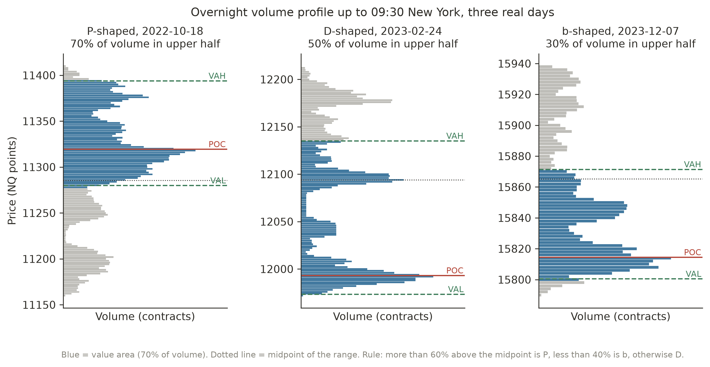
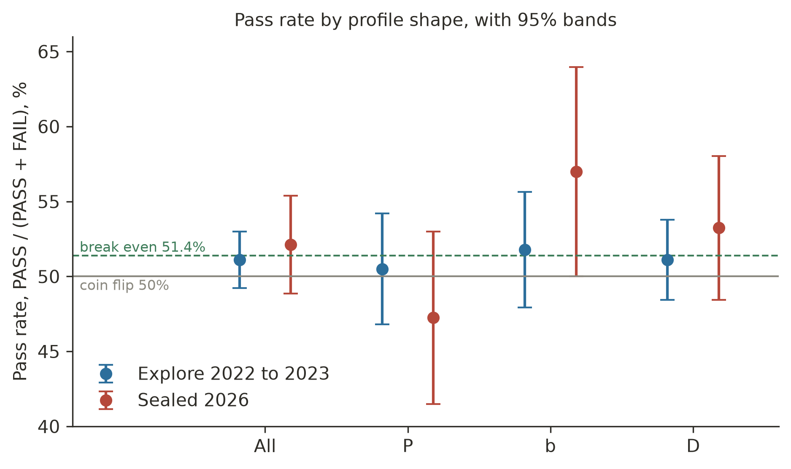
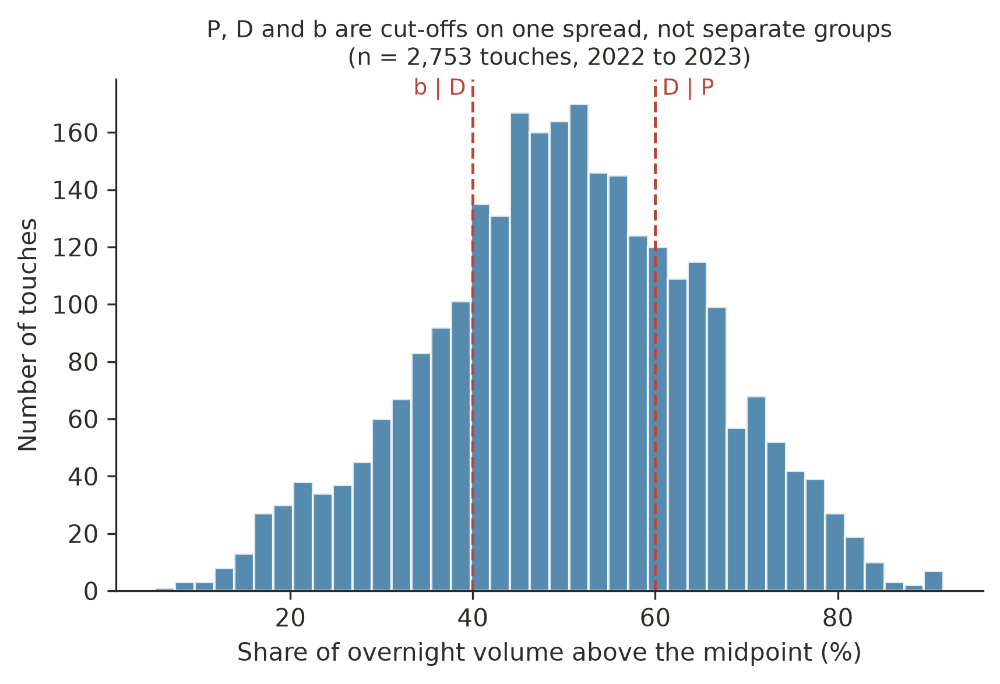
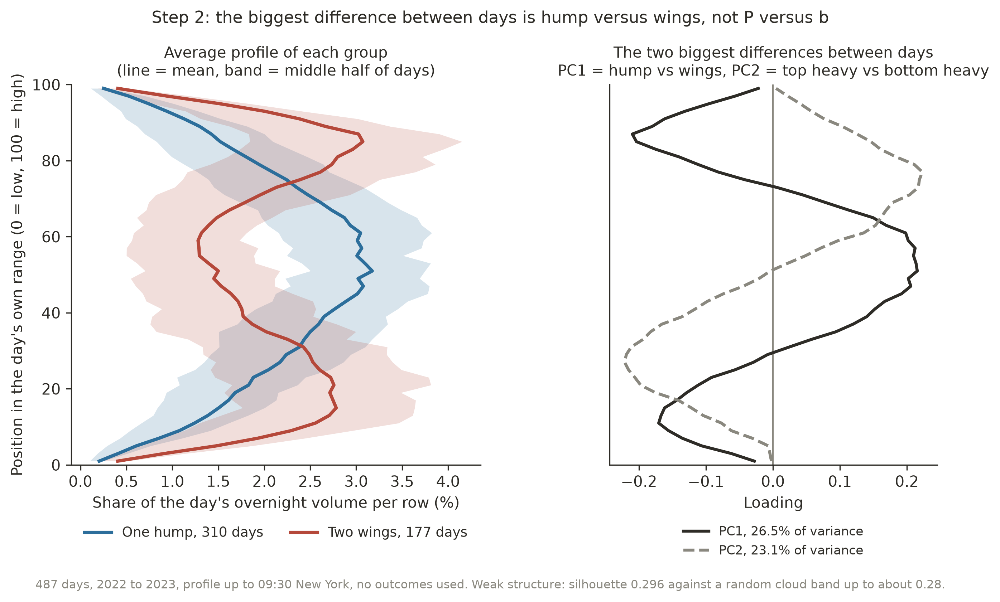
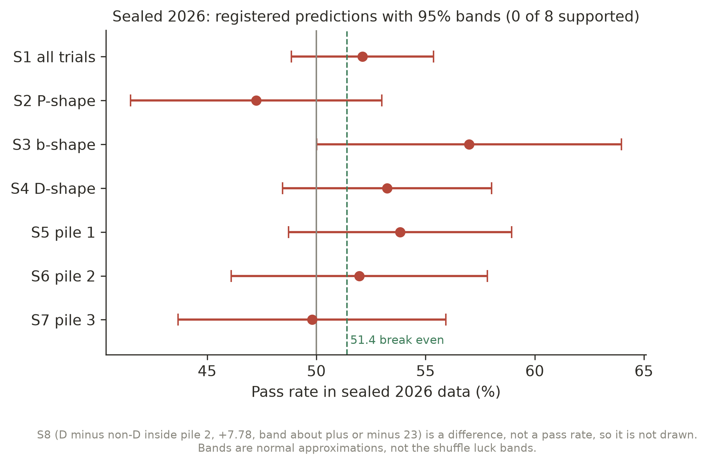
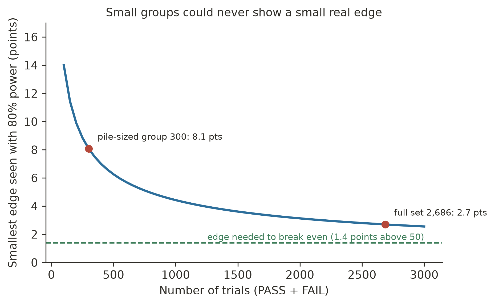

# Volume Profile x Direction (NQ futures)

I tested one idea on NQ futures: when price touches the edge of the overnight volume profile between 09:30 and 11:59 New York, does the shape of that profile say which way price goes next?

I wrote the rules down before I saw results, compared every result with what pure luck gives on the same touches, and sealed the later data. Nothing here is financial advice. I wrote down the bugs I found, because they taught me more than the results did.

**Status: finished. I could not find an edge.** The pass rate was 51.12% on 2,686 counted trades in 2022 to 2023, and luck alone lands between 48.14% and 51.94% about 95 times in 100. None of my 12 registered predictions held. This is not proof that no edge exists. The full set can only see an edge of about 2.7 points, and a 300 trade subset only about 8.

## The idea

Overnight, NQ trades up and down and builds a profile: how much volume traded at each price. The zone where most of the volume traded is the value area. Its top edge is the VAH and its bottom edge is the VAL. Think of it as the price range the market agreed on overnight.

The shape of the profile comes from how much volume sits in the upper half of the range. Above 60% is a **P**, below 40% is a **b**, and in between is a **D**. The reason I wrote down was for P: buyers and sellers find a higher price fair, and when a break from the VAH comes, price should look for higher values. So P expects up, b expects down, and D expects price to fade back into value.



## How it works

1. **Build the profile.** The profile runs from 18:00 to 09:30 New York on 1 minute bars. The value area grows one row at a time and ties go up.
2. **Find touches.** A touch is a bar whose range includes the VAH or the VAL, scanned from 09:30 to 11:59. Entry is the open of the next bar.
3. **Run the trade.** A trade wins if price moves 0.2% of the entry price in the expected direction before it moves 0.2% the other way. There is a 60 bar timeout, and a bar that hits both is called AMBIGUOUS, not guessed. One trade at a time.
4. **Report three numbers.** PASS, FAIL and TIMEOUT. Pass rate is PASS / (PASS + FAIL). A coin flip gives 50%.
5. **Ask what luck gives.** I shuffled the expected direction 1,000 times over the same touches and kept the 2.5th to 97.5th percentile as the luck band.
6. **Split the data by time.** 2022 to 2023 is for exploring. 2024 and 2025 are sealed. 2026 I opened once.

I ran 12 variants for every day: three modes (live, levels frozen at 09:30, levels and shape frozen) times four target types (fixed 0.2%, the opposite level, 5 minute ATR, 15 minute ATR). The headline numbers below are the live mode with the fixed 0.2% target.

## What I found

**The main result (2022-01-03 to 2023-12-31).** 2,753 trades: 1,373 PASS, 1,313 FAIL, 64 TIMEOUT and 3 AMBIGUOUS. That is a pass rate of 51.12% on 2,686 counted. The luck band is 48.14% to 51.94%, so the real number sits inside it. About 13 in 100 luck runs did as well or better. On these rules the data cannot be told apart from luck.



| Shape | Touches | Counted | Pass rate, 2022 to 2023 | Counted, 2026 | Pass rate, 2026 |
|---|---|---|---|---|---|
| P | 724 | 703 | 50.50% | 290 | 47.24% |
| b | 659 | 643 | 51.79% | 193 | 56.99% |
| D | 1,370 | 1,340 | 51.12% | 417 | 53.24% |

**The shapes are not three groups.** The share of volume in the upper half is one smooth spread, and 40 and 60 are lines I drew through it. I also scaled each of the 487 days' profiles to its own range and ran PCA. The biggest difference between days (26.5% of the variance) is whether the volume sits in one hump or in two wings, not P against b. KMeans with two groups gives 310 one hump days and 177 two wings days. The structure is weak: silhouette 0.296 against about 0.28 for a random cloud. No outcomes were used to build this. When I split the touches by hump or wings, the pass rates were 51.50% (1,811 touches) and 50.38% (942).





**Groups of touches and the registered predictions.** When I grouped touches by what is known at touch time, the groups were mostly time of day, shape age and volatility. I wrote 4 predictions down before testing and 0 of 4 held. Then I opened 2026 once. There the pass rate was 52.11% (plus or minus 3.26) on 900 counted trades, and 0 of 8 predictions were supported. That makes 0 of 12.



**What this test could see.** With about 1 point of spread in the luck band, the full set can only see an edge of about 2.7 points. My reason subset (P, VAH, price arriving from below) had 316 touches on 148 days, and a group that size can only see about 8. Small groups could never have shown a small real edge. I keep a ledger of every cut I looked at, and it has 52 looks, so some of them will look good by luck.



**Costs.** I assumed a break even of about 51.4%, which needs 1 NQ point for the round trip. I did not measure the cost. So even the 52.11% in 2026 is not a result I would trade.

## Data status

| Period | Status |
|---|---|
| 2022-01-03 to 2023-12-31 | Explore set, used |
| 2024 | Sealed, never run |
| 2025 | Sealed |
| 2026 | Opened once, on purpose, at the end. It is spent |

Nothing in `Results` was built from 2024 or 2025. The trial files cover 2022 to 2023 and 2026 only.

## Problems I found (and what I did)

1. **Wrong bar positions for 09:30 and 11:59.** I had assumed positions 930 and 1079. That was wrong on 125 of 1,163 usable days (60 of 487 explore days), so the live mode missed the open bar and the frozen modes had lookahead. Found while checking a report against the data. Now the bars are found by time and checked, and I reran everything. Trials went from 25,808 to 25,910 and no result moved by more than 0.5 points. None of the results looked wrong before I found it.
2. **A trade entered after the cut-off.** A touch on the 12:00 bar got in and entered at 12:01. I spotted it in the viewer. The last touch bar is now 11:59.
3. **A fixed 60 points as the target.** A question about 2022 prices showed that 60 points is 0.48% of price in 2022 and 0.21% in 2026. The race was a different test each year. Target and stop are now 0.2% of the entry price.
4. **The first luck run shuffled per day.** Days with only one direction return the same column, so luck equalled the real result. I changed it to one pooled shuffle across all touches.
5. **My first band was too wide.** An early estimate on 5 days was misleading. I replaced it with the band from the 487 days.
6. **A symmetric stop on the moving target.** On the opposite level target the odds were no longer 50% for trades that cross, so the null model now scores each trade against its own odds.
7. **Too many looks.** 12 variants times 3 shapes is 36 looks before I add the rest. Two of 40 cells cleared the bar in one table, which is what luck gives. I cannot fix this, only count it, so the ledger is part of the result.
8. **I opened 2026.** It is no longer a clean set. 2024 and 2025 are still sealed.

## Run it

Python 3.12. The packages and versions are in `requirements.txt`.

The price data is not in this repo. It is third party market data and it holds the sealed years. To reproduce, bring your own 1 minute NQ file with the columns time, open, high, low, close, volume, trades (time in UTC).

```bash
# all 12 variants on a date range
python run_all.py "data/NQ 2022-2026" 2022-01-03 2023-12-31 Results/trials_explore_fixed.csv

# quick check on a small sample file
python run_all.py "data/raw data NQ.csv" 2026-10-27 2026-10-29 Results/trials_test.csv

# the luck band
python luck_run.py

# the figures
python Figures/make_figures.py
python Figures/make_fig6_hump_vs_wings.py
```

A one week run on the sample file was checked on 2026-11-12 and it completes.

## Files

| File | What it does |
|---|---|
| `model/` | Loader, volume profile, shape, ATR, touch finder (`triggers.py`), trial engine (`trails.py`) |
| `model_frozen/` | The same engine with the VAH and VAL, or levels and shape, frozen at 09:30 |
| `run_all.py` | Runs every day, 3 modes x 4 target types, writes a trials CSV |
| `null_model.py`, `luck_run.py` | The shuffle test: 1,000 shuffles of the expected direction on the same touches |
| `tests/` | Step 2 and 3 analysis scripts (profile clustering, groups of touches) |
| `Figures/` | `make_figures.py` (figures 1 to 5) and `make_fig6_hump_vs_wings.py`, PNG at 300 dpi plus PDF |
| `Results/` | `trials_explore_fixed.csv` (2022 to 2023, 25,910 trials, 12 variants), `trials_sealed2026.csv` (2026, 9,534 trials), the step 2 and 3 tables, the sealed run log |
| `day_data.py` | A Streamlit viewer for one day. The file and day are hardcoded at the top |

## Disclaimer

This is research, not financial advice. It does not show a way to make money.
